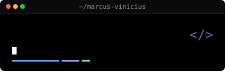

  

 

Sou estudante de Análise e Desenvolvimento de Sistemas, com forte interesse em tecnologia, programação e desenvolvimento de software. Atualmente estou desenvolvendo minhas habilidades em Python, HTML e CSS, buscando transformar o conhecimento acadêmico em aplicações práticas. Já coloquei isso em prática em pequenos projetos. Tenho interesse em entender como a tecnologia pode ser usada para resolver problemas, automatizar processos e desenvolver soluções eficientes. Estou constantemente trabalhando para melhorar minhas habilidades técnicas, aprender novas ferramentas e ganhar experiência prática na área.

###

<h2 data-importer="text" align="left">Connect with me!</h2>

###

 

  
  
  

###

<h2 data-importer="text" align="left">My stack</h2>

###

 

  
  
  
  
  
  
  

###

 

<picture data-importer="pacman">
  <source media="(prefers-color-scheme: dark)" srcset="https://raw.githubusercontent.com/marcusvini-dev/marcusvini-dev/pacman-output/pacman-contribution-graph-dark.svg?game=pacman">
  <source media="(prefers-color-scheme: light)" srcset="https://raw.githubusercontent.com/marcusvini-dev/marcusvini-dev/pacman-output/pacman-contribution-graph.svg?game=pacman">
  
</picture>

###
